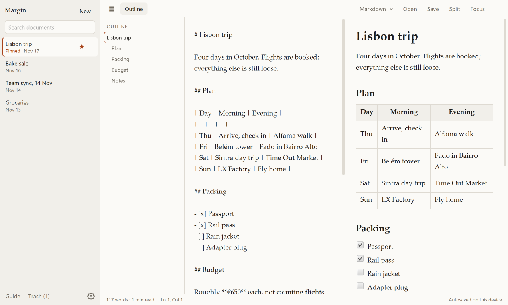

# Margin

A quiet text editor for the browser and the desktop. Documents are saved on your own device as you type; nothing is uploaded and there is no account.

- **Use it in a browser:** https://pymite6941.github.io/margin/
- **Guide:** https://pymite6941.github.io/margin/docs/



## Run it

| How | What to do |
| --- | --- |
| In a browser, any device | Open https://pymite6941.github.io/margin/. Nothing to install. It keeps working offline after the first visit, and Chrome, Edge and phones offer "Install" to add it as an app |
| Desktop app | Run the install command for your system below, or download from [Releases](https://github.com/PyMite6941/margin/releases/latest) |
| Java window | Download `Margin-Java-<system>.zip` from [Releases](https://github.com/PyMite6941/margin/releases/latest), unzip, run `Margin` inside. Or from source: `npm install && npm run java` (needs a JDK 21 or newer) |
| From source | `git clone https://github.com/PyMite6941/margin && cd margin && npm install && npm run desktop` (needs Node.js 20 or newer) |

### Install the desktop app

**Windows** (PowerShell). One installer for x64 and ARM64; it installs for your user only, adds Margin to the Start menu and the desktop, and opens it:

```powershell
curl.exe -L -o "$env:TEMP\Margin-Setup.exe" https://github.com/PyMite6941/margin/releases/latest/download/Margin-Setup.exe; & "$env:TEMP\Margin-Setup.exe"
```

**Debian, Ubuntu, Raspberry Pi OS** (x86-64 and ARM64). This installs the app with everything it needs and adds it to the applications menu:

```sh
curl -L -o /tmp/margin.deb "https://github.com/PyMite6941/margin/releases/latest/download/Margin-$(dpkg --print-architecture).deb" && sudo apt install -y /tmp/margin.deb
```

Then run `margin` or pick Margin from the menu. Remove it with `sudo apt remove margin`.

**Other Linux** (portable AppImage, nothing installed system-wide):

```sh
curl -L -o Margin.AppImage "https://github.com/PyMite6941/margin/releases/latest/download/Margin-$(uname -m | sed s/aarch64/arm64/).AppImage"
chmod +x Margin.AppImage
./Margin.AppImage --appimage-extract-and-run
```

`--appimage-extract-and-run` makes it work on systems without FUSE 2 (most current distributions); with `libfuse2` installed you can leave it off and it starts faster.

**macOS** (Terminal; Apple silicon and Intel, macOS 12 or newer). This copies Margin into Applications and opens it:

```sh
curl -L -o /tmp/Margin.dmg "https://github.com/PyMite6941/margin/releases/latest/download/Margin-$(uname -m | sed s/x86_64/x64/).dmg" && hdiutil attach -nobrowse -quiet /tmp/Margin.dmg && cp -R /Volumes/Margin/Margin.app /Applications/ && hdiutil detach -quiet /Volumes/Margin && open /Applications/Margin.app
```

Or download `Margin-arm64.dmg` (Apple silicon) or `Margin-x64.dmg` (Intel) from [Releases](https://github.com/PyMite6941/margin/releases/latest), open it and drag Margin to Applications.

The installers are not signed with a paid developer certificate yet. If Windows shows a SmartScreen prompt, choose More info, then Run anyway. On macOS, a downloaded app is blocked the first time: open System Settings → Privacy & Security, scroll down and choose Open Anyway (the Terminal command above avoids this).

### Keep it in the taskbar or Dock

| System | How |
|---|---|
| Windows | Start Margin, right-click its taskbar button and choose **Pin to taskbar**. Right-click the pinned icon for **New document** and recent files |
| macOS | Start Margin, right-click its Dock icon and choose **Options → Keep in Dock**. Right-click it for **New Document**; drop a file on it to open the file |
| Linux | Margin is in the applications menu after installing the `.deb`; pin it from there or from the dock (right-click → Add to Favorites / Pin) |
| Browser | In Chrome or Edge, use **Install Margin** in the address bar (or the menu → Cast, save and share → Install). It then opens in its own window and can be pinned like any app, and can open `.md`, `.txt` and `.html` files |

The desktop apps open `.md` and `.markdown` files with a double-click, and appear under **Open With** for `.txt` and `.html`. Only one Margin window runs: opening another file sends it to the window you already have.

## What it does

- A sidebar of documents with search; the first line is the title. Pin documents to the top
- **Version history**: snapshots on open, every few minutes of editing, and before any wholesale rewrite; see what changed, name versions, restore or open one as a copy
- **Trash**: deleting is undoable, and deleted documents can be put back for 30 days
- **Outline** of the document's headings beside the text; click to jump
- Three document types, each saved as its own file type: Markdown (`.md`), HTML (`.html`) and plain text (`.txt`)
- Write, Split and Read views; HTML previews in a sandbox with scripts off
- **Tidy** re-indents HTML tags; a Markdown document switched to HTML is converted
- Focus mode, light and dark themes, three typefaces, adjustable text size and line width
- Find and replace with match counts, match case, whole words and regular expressions
- Markdown tables and checklists you can tick in the preview
- Lists that continue on Enter, Tab to indent, Ctrl+B, Ctrl+I, Ctrl+K for links, Ctrl+Alt+1-6 for headings, Ctrl+Shift+7/8/9 for lists
- Make a copy; export as a standalone web page or as plain text; print or save as PDF
- Opens and saves `.md`, `.markdown`, `.html`, `.htm` and `.txt` files; drag a file in to open it
- Settings behind the gear at the foot of the sidebar: appearance, line spacing, spell check, wrapping, indent width, auto-closing brackets and HTML tags, default document type, list sorting, keeping saved files up to date as you type, backup export/import, and a shortcut list
- Optional AI from any provider you choose (see below)
- Word count (of the selection too), reading time and cursor position

The guide has a [comparison with Google Docs](https://pymite6941.github.io/margin/docs/#google-docs): Margin takes what works without a server (history, outline, trash, find options, checklists, export) and leaves out what needs one (live collaboration, sharing, comments).

## AI, bring your own

Margin ships no AI and none runs by default. In Settings → AI you add **accounts**: pay-as-you-go API keys (OpenAI, Anthropic, OpenRouter, Mistral, any OpenAI- or Anthropic-compatible address), subscription allowances that include API access (GitHub Models, with higher limits on Copilot plans), free tiers (Gemini via AI Studio, Groq) and local models (Ollama, LM Studio). Each account has its own model, a usage count (requests today and this month, tokens), an optional limit (requests or tokens, per day or month), and you pick which is in use. With automatic switching on, a used-up, rate-limited or refused account hands over to the next. Chat-app subscriptions (ChatGPT Plus, Claude Pro) have no API access, so they cannot be connected.

Accounts and keys live in a `.env` file (`MARGIN_AI_<FIELD>_<NAME>` lines, editable by hand): the app data folder for the Electron app (`%APPDATA%\Margin\.env`, `~/Library/Application Support/Margin/.env`, `~/.config/Margin/.env`), `~/.margin/.env` for the Java window, and the same text in `localStorage` in a browser, with download and load buttons. `.env` files are git-ignored.

Once an account with a model is in use, one **AI** button (Ctrl+J) appears: give an instruction and the reply replaces the selection, or the whole document. Ctrl+Z undoes it.

Keep it that way. **No AI bloat:** no SDKs, no chat panel, no background calls, no AI anywhere unless the user turned it on. All of it lives in `src/lib/ai.js` (services and one `fetch`), `src/lib/keys.js` (accounts, the `.env` file, usage), `src/components/Accounts.jsx` and the `AiBar` in `src/components/Editor.jsx`. A key goes only to its own account's address. The desktop shells pass requests through `window.desktop.request`, so local servers and providers without CORS work there.

## Develop

Needs Node.js 20 or newer.

```sh
npm install
npm run dev          # web app with live reload, http://localhost:5173
npm run build        # static site in dist/
npm run desktop      # build, then open the desktop app
npm run desktop:dev  # desktop app pointed at the dev server (run `npm run dev` first)
npm run java         # build, then open the Java window (needs a JDK 21+; fetches JavaFX into java/lib/ once)
npm run java:package # self-contained Java app in release/java (add `-- exe`, `-- deb`, ... for an installer)
npm run package      # build an installer into release/ (downloads electron-builder on first use)
```

To publish installers for every system, push a version tag (bump `version` in `package.json`, then `git tag v0.2.0 && git push --tags`). `.github/workflows/release.yml` builds them and attaches them to a GitHub release. Code signing is not set up yet; it goes in the `build` section of `package.json`.

## How it is put together

One React app, three ways to run it. The web build is what GitHub Pages serves. The Electron app and the Java window both load that same build and add native file dialogs through the same `window.desktop` bridge (`open`, `save`, `request`).

| Path | Purpose |
| --- | --- |
| `src/App.jsx` | State and layout: documents, preferences, toolbar, status bar |
| `src/components/Editor.jsx` | The textarea and its keyboard behaviour |
| `src/components/Sidebar.jsx` | Document list, search, pinning and the trash |
| `src/components/History.jsx` | Version history dialog |
| `src/components/Menu.jsx` | The ⋯ drop-down menu |
| `src/lib/history.js` | Version snapshots, kept apart from the documents |
| `src/lib/diff.js` | Line-then-word comparison behind version history |
| `src/lib/outline.js` | Headings for the outline |
| `src/lib/exporting.js` | Export as a web page or plain text |
| `src/lib/modes.js` | Document types (Markdown, HTML, plain text) and their extensions. **Add new file types here** |
| `src/lib/files.js` | Opening and saving files |
| `src/lib/tidy.js` | HTML indenter behind Tidy |
| `src/lib/ai.js` | Optional bring-your-own AI: services and the request. Keep it small |
| `src/lib/keys.js`, `src/lib/env.js` | AI accounts in a `.env` file, usage and limits, switching |
| `src/components/Accounts.jsx` | Settings → AI |
| `src/components/Settings.jsx` | The settings dialog behind the gear. New preferences also need a default in `DEFAULT_PREFS` (`src/lib/storage.js`) |
| `src/lib/storage.js` | Documents (including the trash) and preferences in `localStorage` |
| `src/lib/editing.js` | Formatting shortcuts, indenting, lists, links, headings, find and replace |
| `src/lib/markdown.js` | The Markdown renderer behind the preview |
| `desktop/main.cjs` | Electron window, `app://` file server, open and save handlers |
| `desktop/preload.cjs` | The `window.desktop` bridge the page uses on desktop |
| `java/src/margin/Margin.java` | Java window: JavaFX WebView, the same `window.desktop` bridge |
| `scripts/java.mjs` | Fetches JavaFX, compiles, runs or packages the Java window |
| `public/docs/` | User guide, published alongside the app. Screenshots are in `public/docs/img/` |
| `scripts/icons.py` | Draws every app icon (taskbar, Dock, web app, installers) from the shapes in `public/icon.svg`. Needs Pillow |
| `public/sw.js`, `src/lib/offline.js` | Offline support and install for the web version |
| `public/icon.svg`, `build/icon.png` | App icon (web and installers) |
| `.github/workflows/pages.yml` | Builds and deploys to GitHub Pages on every push to `main` |
| `.github/workflows/release.yml` | Builds desktop installers when a `v*` tag is pushed |

`src/lib/files.js` picks the best backend available: `window.desktop` in the desktop app, the File System Access API in Chrome and Edge, and upload/download elsewhere. Nothing outside that file knows which one is in use.

The desktop apps can only write to paths the user chose in a dialog during that session (see `granted` in `desktop/main.cjs` and `Margin.java`).

The packaged Java app does not start from a folder whose path has non-ASCII characters (a jpackage launcher limit), so keep `release/java` copies somewhere like `C:\Apps`. Normal install locations are fine.

## License

MIT. See [LICENSE](LICENSE).
